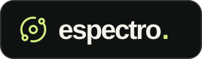
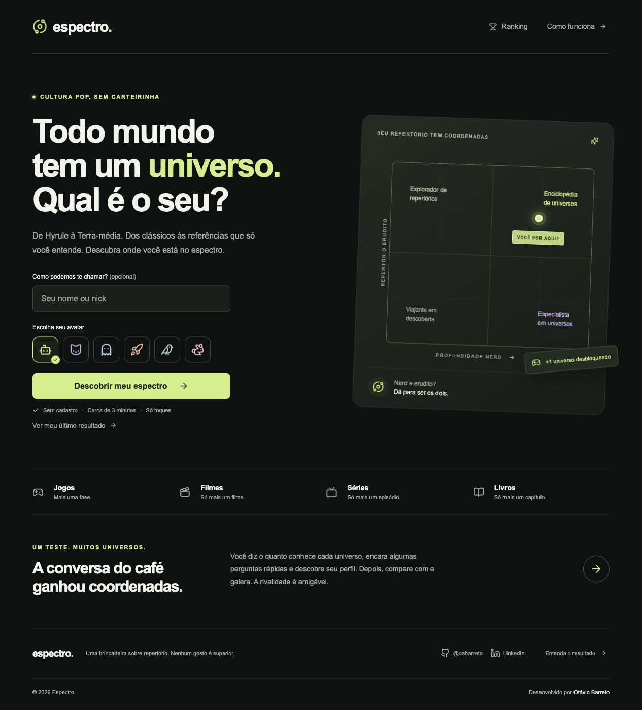

<div align="center">

<h1></h1>

**Todo mundo tem um universo. Qual é o seu?**

Um quiz de cultura pop que transforma repertório em coordenadas.


[**Acessar o Espectro**](https://espectro-app.vercel.app/) · [O projeto](#de-uma-conversa-no-trabalho-a-um-projeto) · [Experiência](#como-é-usar) · [Decisões técnicas](#por-trás-da-experiência) · [Rodar localmente](#experimente)

</div>



## De uma conversa no trabalho a um projeto

O Espectro nasceu de uma discussão descontraída entre colegas: conhecer uma saga de livros é coisa de nerd ou de erudito? E dominar uma franquia de jogos? Onde entram filmes e séries nessa história?

A ideia foi levar a brincadeira para a web. Em vez de colocar todo mundo em uma única escala, o projeto usa dois eixos: **profundidade nerd** e **repertório erudito**. Dá para se especializar em poucos universos, conhecer um pouco de muitos ou reunir os dois perfis.

O resultado é um retrato divertido de uma seleção de obras, não uma avaliação de inteligência ou uma regra sobre quem pode gostar de quê.

## Como é usar

A experiência foi pensada para caber em uma pausa para o café:

1. Escolha um avatar e, se quiser, informe seu nome ou nick.
2. Escolha uma sessão de **3, 5 ou 8 minutos**, no seu ritmo.
3. Responda a cartões de familiaridade e perguntas de múltipla escolha sobre jogos, filmes, séries e livros.
4. Veja sua posição na matriz, descubra seu perfil e compare os pontos no ranking.

O nome é opcional; também dá para sortear um nick com um toque, entre 576 combinações sem números. As respostas são feitas por cliques ou toques, sem cadastro. O app lembra o último resultado naquele navegador e permite refazer o teste.

O catálogo inicial reúne **41 universos e 41 perguntas em português**, incluindo As Crônicas de Nárnia e Love, Death & Robots. As sessões sorteiam 20, 32 ou 48 etapas, com as quatro categorias equilibradas e alternativas embaralhadas. A duração é uma estimativa, sem cronômetro.

**O que já está implementado**

- Skeletons no carregamento inicial, no ranking e durante a preparação e correção do desafio.
- Feedback de acerto, erro ou pulo após cada pergunta, com resposta correta.
- Resumo final com contadores de acertos, erros e pulos.
- Favicon com o símbolo orbital da marca.
- Catálogo persistido no Neon, com seleção de perguntas feita no servidor.
- Sessões com gabarito reservado ao servidor e pontuação normalizada por duração.
- Doze avatares para escolher ou sortear, exibidos no resultado, no ranking e no card.
- Matriz com duas pontuações independentes, de 0 a 100.
- Classificação com perfil e subtipo, como **Nerd — Curioso de carteirinha**.
- Ranking ordenado por pontuação geral, nerd ou erudita.
- Card de resultado em PNG, com avatar, perfil, matriz, resumo do desafio e posição no ranking. Compartilhe pelo dispositivo ou baixe a imagem para enviar nas redes.
- Interface responsiva, foco visível para navegação por teclado e animações que respeitam a preferência por movimento reduzido.

## Como o perfil é definido

**Nerd** representa a profundidade nos cinco universos que a pessoa declara conhecer melhor, combinada com os acertos no desafio. **Erudito** representa a familiaridade nas quatro categorias, com pesos iguais, combinada com questões sobre obras, autores e contexto.

Cada eixo combina **60% de autoavaliação e 40% de acertos**. O maior define o perfil dominante; se a diferença for de até 10 pontos, o resultado será **Nerd + Erudito**. O subtipo acompanha a faixa de pontuação, de *Viajante em descoberta* a *Enciclopédia de universos*.

Esses critérios também estão explicados na interface. A pontuação geral do ranking é a média dos dois eixos. [Veja as faixas e os detalhes de implementação](docs/DEVELOPMENT.md#perfis-e-subtipos).

## Por trás da experiência

O projeto reúne interface, regras de pontuação e persistência em uma aplicação **Next.js com React e TypeScript**, preparada para publicação na Vercel. A interface usa CSS próprio e ícones Lucide; o ranking compartilhado usa PostgreSQL por meio do Neon.

Algumas decisões que orientam a implementação:

- **Poucos passos para começar.** Nick opcional e um avatar padrão permitem entrar direto no teste.
- **Pontuação calculada no servidor.** A API recebe respostas, nick e avatar, valida os dados e calcula o resultado. O navegador não envia uma pontuação pronta para o ranking.
- **Regras separadas da interface.** Catálogo, avatares, classificação e cálculo ficam em módulos próprios, para facilitar ajustes e testes.
- **Uma participação por identidade do navegador.** Um cookie `HttpOnly` identifica a entrada. Refazer o teste atualiza a participação, em vez de acumular resultados.
- **Modo local para experimentar.** Sem banco configurado, o teste continua funcionando e o ranking mostra apenas o resultado salvo naquele navegador, com essa condição informada na tela.

A identidade por navegador mantém a brincadeira simples. Ela não substitui autenticação e não impede uma pessoa de participar novamente usando outro navegador.

## Experimente

Use Node.js 22, ou uma versão compatível a partir da 20.19.

```bash
git clone https://github.com/oabarreto/espectro-app.git
cd espectro-app
npm install
npm run dev
```

Abra **http://127.0.0.1:3000**.

Para verificar as regras de pontuação e gerar a versão de produção:

```bash
npm test
npm run build
```

Os testes cobrem os limites de pontuação, as faixas dos subtipos, o equilíbrio entre perfis, a validação das respostas e o avatar selecionado.

**Para usar com a galera:** configure `DATABASE_URL` com a conexão de um banco Neon e publique o repositório na Vercel. Sem essa variável, a aplicação funciona no modo local. O [guia de desenvolvimento](docs/DEVELOPMENT.md) explica a configuração e os limites dessa primeira versão.

---

### Quem está por trás

**Otávio Barreto**

O Espectro é um projeto pessoal para explorar uma ideia de produto do início ao uso: transformar uma conversa em uma experiência simples, cuidar da apresentação dos resultados e conectar a interface às regras e à persistência.

[GitHub](https://github.com/oabarreto) · [LinkedIn](https://www.linkedin.com/in/oabarreto)
